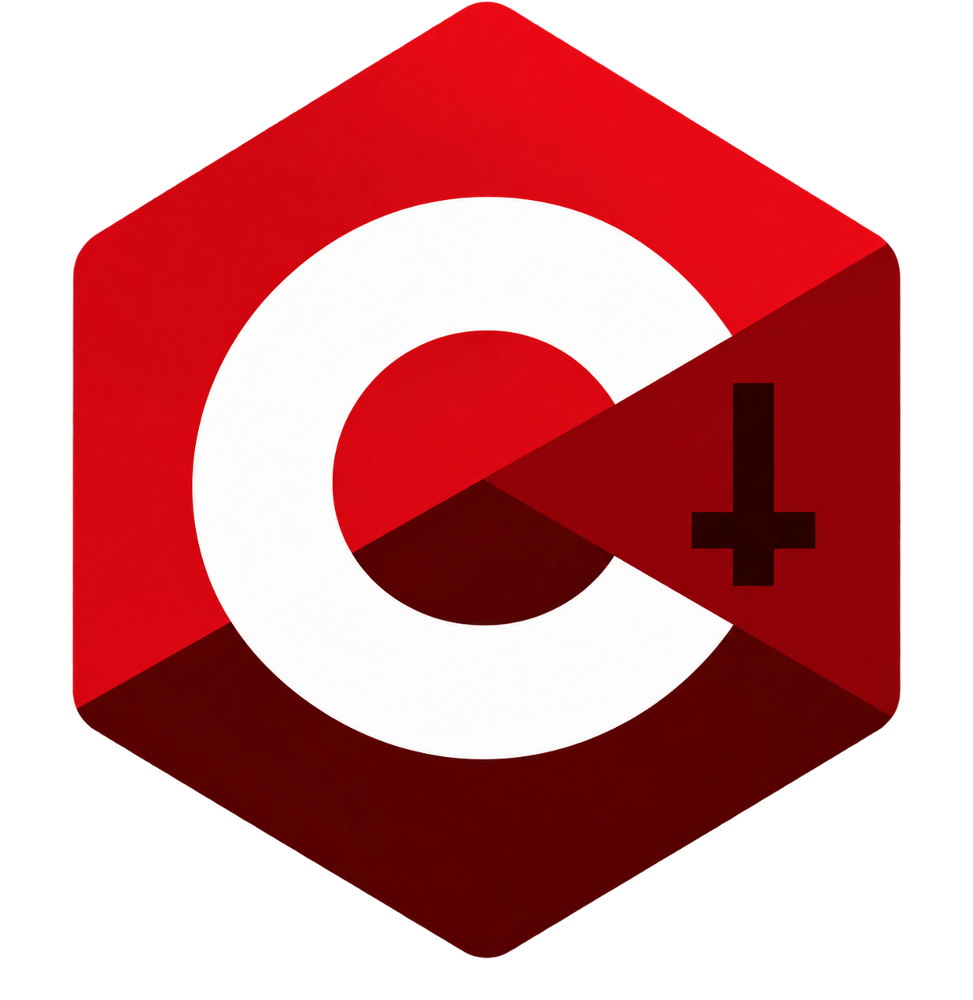

# Demonic C

<p align="center">
  
</p>

<p align="center">
  <strong>A self-hosting systems programming language that compiles to C with native performance, modern ergonomics, and direct hardware control.</strong>
</p>

[](https://github.com/ak495867/Demonic-C/commits/main)
[](https://isocpp.org/)
[](https://en.wikipedia.org/wiki/C_(programming_language))
[](https://github.com/ak495867/Demonic-C)
[](https://github.com/ak495867/Demonic-C)
[](LICENSE.md)

> **Naming note:** the `.dmc` extension is a nod to *Devil May Cry* — high speed, absolute precision, and serious style.

---

## ⚡ Quick Install

Install Demonic C directly from your terminal in seconds:

### Linux & macOS (bash / zsh)
```bash
curl -fsSL https://raw.githubusercontent.com/ak495867/Demonic-C/main/install.sh | bash
```
*Or via wget:*
```bash
wget -qO- https://raw.githubusercontent.com/ak495867/Demonic-C/main/install.sh | bash
```

### Windows (PowerShell)
```powershell
irm https://raw.githubusercontent.com/ak495867/Demonic-C/main/install.ps1 | iex
```

The installer detects your operating system and CPU architecture, downloads the latest pre-compiled release from GitHub, extracts it to `~/.dmc`, and configures your `PATH`.

---

## Overview

Demonic C (DMC) is a systems programming language designed for low-level control without sacrificing modern developer ergonomics. It compiles to clean, portable C99/C11, which is then built by any standard C compiler (GCC, Clang, MSVC) — giving DMC programs the raw execution speed and predictable memory layout of hand-written C, coupled with high-level language safety and expressiveness.

DMC is **self-hosting**: its own compiler is written in DMC and compiles itself into C, producing a complete multi-stage bootstrap chain.

### Core Capabilities

- **Compile-Time Null Safety**: Strict `?*T` (nullable) vs `*T` (non-nullable) pointer types with static verification and scope narrowing in `if (p != null)`.
- **Ergonomic Error Propagation**: Zero-cost systems error bubbling with the `try` keyword (`let val = try expr;` and `try expr;`).
- **Monomorphized Lightweight Generics**: Type-safe generic `Vector<T>` with zero `void*` overhead, compiling down to specialized C structs (`Vector_int`, `Vector_Point`).
- **Compile-Time Execution & Asset Embedding**: `#embed("file")` static byte arrays, `#embed_str("file")` escaped strings, `#embed_size("file")`, and `comptime { ... }`.
- **C-Family Language Interoperability**: Zero-overhead ABI interoperability with C and C++, external function declarations (`extern fn`, `extern "C"`), source linker directives (`#link "lib"`), inline C blocks (`c_code { ... }`), and mixed-source compilation (`dmc main.dmc helper.c -lcurl`).
- **Direct C Header Ingestion**: First-class C header integration (`import "stdio.h";`, `import <math.h>;`, `include <header.h>;`).
- **First-Class Arena Allocators**: Built-in bump allocation (`arena_new`, `a.alloc_bytes(sz)`, `a.reset()`, `a.used()`, `a.free()`).
- **LSP 2.0 & Editor Intelligence**: Full LSP server with Go to Definition (`textDocument/definition`), Markdown tooltips (`textDocument/hover`), and inline diagnostics.
- **Git-Based Package Manager**: Install dependencies directly from GitHub via `dmc pkg add <git-url>` with automatic `dmc.toml` tracking.
- **Modern Ergonomics**: LIFO `defer` cleanup, tagged unions / payload enums, string slicing (`s[0..5]`), and zero-cost method call syntax (`val.method(...)`).
- **Instant Build Caching**: Content-hashed build cache in `~/.dmc/cache` gives sub-5ms repeated execution speeds.
- **Interactive REPL & Watch Mode**: Interactive REPL (`dmc repl`) and file watcher (`dmc watch`) for ultra-fast iteration.
- **Hardware & OS Access**: Low-level port I/O (`port_in_b`, `port_out_b`), inline assembly, process control, and system calls.

### Developer CLI Commands

| Command | Description |
|---|---|
| `dmc <file.dmc>` | Instant compile and cached native execution (`< 5ms`) |
| `dmc build <file.dmc>` | Directly compiles to optimized executable binary |
| `dmc check <file.dmc>` | Fast syntax, semantic, and type check without compilation |
| `dmc watch <file.dmc>` | Live reload and rerun on file save |
| `dmc repl` | Interactive Read-Eval-Print Loop |
| `dmc clean` | Cleans compilation cache and temporary artifacts |
| `dmc heal` / `dmc doctor` | Diagnoses toolchain health and self-heals corrupted state |
| `dmc update` | Self-updater that checks and updates DMC to the latest release |
| `dmc info` / `dmc env` | Displays toolchain backend, directories, and target architecture |
| `dmc test [dir]` | Executes unit test suite (`#[test]`) |
| `dmc bench [dir]` | Executes performance benchmark suite (`#[bench]`) |
| `dmc tree [file.dmc]` | Visualizes project module import hierarchy |
| `dmc tokens <file.dmc>` | Dumps lexed token stream for compiler inspection |
| `dmc lsp` | Starts Language Server Protocol daemon for editors (`--install-vscode`) |
| `dmc pkg add <git-url>` | Clones Git package and registers in `dmc.toml` |

---

## Project Layout

| Directory / File | Description |
|---|---|
| `compiler/` | C++20 compiler implementation (`dmc.cpp`) with AST, lexer, codegen, and CLI engine |
| `runtime/` | Modular C runtime library (`runtime/dmc_runtime.c`, `runtime/core/`, `mem/`, `fs/`, `net/`) |
| `stdlib/` | DMC standard-library modules (`strings`, `path`, `time`, `fs`, `os`, `crypto`, `math`, `buffer`, `random`, `log`, `testing`, `json`, `http`, `db`, `regex`, `datetime`) |
| `test-files/` | Unit tests (`#[test]`), feature tests (`modern_features.dmc`), and bootstrap chain (`emit.dmc`, `selflex.dmc`) |
| `build/` | Makefile and shell build scripts |
| `bin/` | Pre-compiled compiler executables and runtime static libraries |
| `.github/workflows/` | Multi-platform CI matrix and GitHub Releases automation |
| `install.sh` | Cross-platform Unix one-line installer script |
| `install.ps1` | Windows PowerShell one-line installer script |
| `docs/` | Architecture specs and language documentation |
| `packages/` | Local package registry and package metadata |
| `editor/` | VS Code extension foundation and language syntax definitions |
| `playground/` | Interactive web playground |
| `examples/` | Standalone example programs |

---

## Key Features & Code Examples

### 1. Modern Scope Cleanup (`defer`)
Execute cleanup statements automatically when exiting functions or blocks in LIFO order:

```dmc
fn process_file(path: string) {
    let f = file_open(path, "r");
    if (f < 0) { return; }
    defer file_close(f);

    let content = file_read(f);
    println(content);
}
```

### 2. Tagged Unions & Enums with Payloads
Express algebraic data types and pattern-matched results with type safety:

```dmc
enum Result {
    Ok(string),
    Err(int)
}

fn fetch_data() -> Result {
    return Result_Ok("Payload received!");
}

fn main() {
    let res = fetch_data();
    if (res.tag == Result_Ok) {
        println(res.data.Ok);
    }
}
```

### 3. Zero-Cost Method Call Syntax & Struct Methods
Write object-style method calls that lower directly to static C function invocations with zero overhead:

```dmc
struct Point {
    x: int;
    y: int;
}

fn Point_length(p: Point) -> int {
    return p.x * p.x + p.y * p.y;
}

fn main() {
    let p = Point { x: 3, y: 4 };
    let len_sq = p.length();
    println(len_sq);

    let s: string = "Demonic C";
    println(s.len());
    let sub = s.slice(0, 7);

    let v = vec_new();
    v.push(42);
    println(v.get(0));
    v.free();
}
```

### 4. High-Level Standard Library Modules
Clean, modern standard library modules for Strings, Paths, Time, Randomness, Buffers, Logging, Filesystem, OS, and Cryptography:

```dmc
import "strings";
import "path";
import "time";
import "random";
import "fs";
import "os";
import "crypto";
import "log";

fn main() {
    log_info("Demonic C starting up...");
    let target = path_join("data", "output.txt");
    fs_write(target, "Demonic speed!");
    let content = fs_read(target);
    let hash = sha256(content);
    println(hash);
    println(time_millis());
}
```

### 5. C-Family Interoperability & Mixed Source Builds
Call external C/C++ libraries seamlessly with zero runtime overhead, declare external functions, link libraries directly, embed inline C snippets, and compile mixed source projects:

```dmc
#link "m"

extern fn puts(s: string) -> int;
extern fn sqrt(x: f64) -> f64;
extern "C" fn cos(x: f64) -> f64;

extern "C" {
    fn sin(x: f64) -> f64;
    fn pow(base: f64, exp: f64) -> f64;
}

c_code {
    static int fast_double(int n) { return n * 2; }
}

extern fn fast_double(n: int) -> int;

fn main() {
    let s = sqrt(49.0);
    println(s);

    let d = fast_double(21);
    println(d);
}
```

Compile mixed `.dmc` and `.c` files in a single command:
```bash
dmc main.dmc helper.c -lcurl
```

### 6. String Slicing
Direct, memory-safe sub-slice expressions:

```dmc
fn main() {
    let text: string = "Demonic C Systems Language";
    let sub = text[0..9];
    println(sub);
}
```

### 7. Built-in Testing Engine
Write unit tests directly in your `.dmc` files using the `#[test]` attribute:

```dmc
#[test]
fn test_addition() -> int {
    if (2 + 2 == 4) { return 0; }
    return 1;
}
```

Run the entire test suite across your codebase:
```bash
dmc test test-files
```

### 8. Compile-Time Null Safety
Nullable pointers (`?*T`) prevent null dereference errors at compile time. Pointers are safely narrowed within `if (ptr != null)` blocks:

```dmc
struct Node {
    val: int;
}

fn process_node(node: ?*Node) {

    if (node != null) {
        node.val = 42;
    }
}
```

### 9. Ergonomic Error Bubbling (`try`)
Systems error codes (< 0) are automatically bubbled up to the caller with zero runtime overhead:

```dmc
fn read_config(path: string) -> int {
    let fd = try file_open(path, "r");
    try file_write(fd, "test");
    return 0;
}
```

### 10. Monomorphized Lightweight Generics (`Vector<T>`)
Zero-cost, type-safe dynamically sized arrays specializing to native C structs:

```dmc
let v: Vector<int> = Vector<int>::new();
v.push(10);
v.push(20);
println(v[1]);
println(v.len());
let popped = v.pop();
v.free();
```

### 11. Compile-Time Asset Embedding & Direct C Headers
Embed files directly into the compiled executable at compile time, and import raw C headers without boilerplate:

```dmc
import "stdio.h";
import "math.h";

let banner = #embed_str("banner.txt");
let raw_bytes = #embed("icon.png");
let icon_sz = #embed_size("icon.png");
let hash_init = comptime { 0x6a09e667 };

fn main() {
    puts(banner);
}
```

### 12. First-Class Bump Arenas
Fast $O(1)$ allocation with bulk cleanup:

```dmc
let a: arena = arena_new(1024 * 1024);
let buf1 = a.alloc_bytes(256);
let buf2 = a.alloc_bytes(512);

println(a.used());
a.reset();
a.free();
```

---

## CLI Toolchain Usage

The unified `dmc` executable provides a complete development toolkit:

```bash
# Run any DMC program directly (cached in ~/.dmc/cache, <5ms subsequent runs!)
dmc app.dmc

# Pass runtime arguments directly to your program
dmc app.dmc arg1 arg2

# Hot-reloading watch mode: rerun whenever file changes
dmc watch app.dmc

# Interactive REPL: test expressions and statements on the fly
dmc repl

# Run with AddressSanitizer and UndefinedBehaviorSanitizer
dmc app.dmc --sanitize

# Install VS Code / Cursor language extension directly in one click
dmc lsp --install-vscode

# Build a DMC program directly to a permanent native binary
dmc build app.dmc -o bin/app

# Transpile to C code without running
dmc app.dmc -o app.c

# Run all #[test] functions in a folder
dmc test test-files

# Start Language Server Protocol daemon
dmc lsp

# Format DMC source code
dmc fmt src/main.dmc

# Lint DMC source code
dmc lint src/main.dmc

# Create a new project scaffold
dmc new my-project

# Package management: Git-based or registry
dmc pkg add https://github.com/user/dmc-pkg.git
dmc pkg search json
dmc pkg install json
```

For advanced options, see [`USAGE.md`](USAGE.md).

---

## Self-Hosting & Bootstrap Verification

DMC's self-hosting compiler can compile its own bootstrap stage:

```bash
# 1. Compile the DMC stage emitter to C using the DMC compiler
./bin/dmc test-files/emit.dmc -o test-files/_stage_emit.c

# 2. Compile the generated C to an executable stage emitter
gcc -std=c11 -w test-files/_stage_emit.c -o test-files/_stage_emit -lws2_32

# 3. Use the stage emitter to emit the selflex stage lexer
cd test-files
./_stage_emit selflex.dmc selflex_stage_out.c

# 4. Compile the selflex stage and run it
gcc -std=c11 -w selflex_stage_out.c -o selflex_stage -lws2_32
./selflex_stage   # Correctly validates 1317 tokens and exits with code 37
```

---

## Contributing

Contributions are warmly welcomed! Please review [CONTRIBUTING.md](CONTRIBUTING.md) for details on code style, testing requirements, and pull request submissions.

## License

Demonic C is distributed under the open-source MIT License. See [LICENSE.md](LICENSE.md) for full license text.
